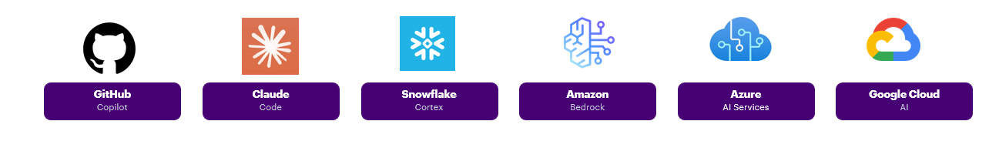
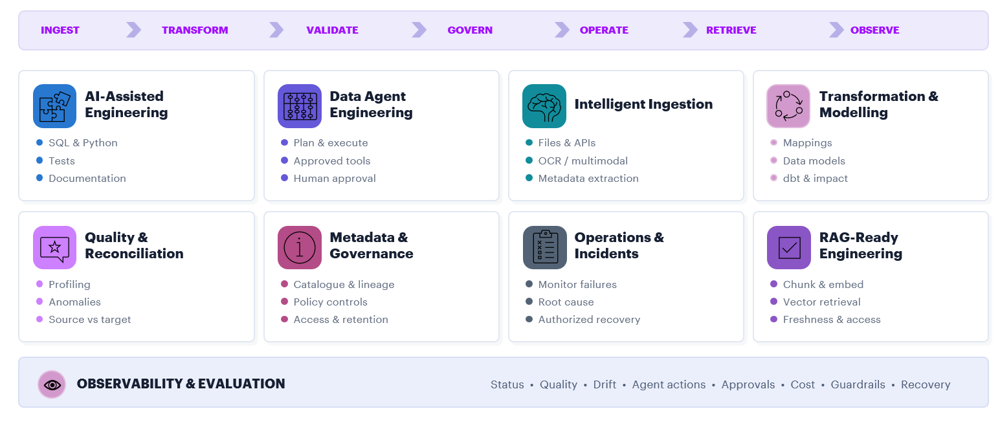

# AI Data Engineering

### AI Competency

AI Data Engineers design, build, run, and manage the data systems and data agents that power enterprise AI. They combine traditional data engineering with AI-assisted development, automated data processing, data quality checks, and AI-ready data design..

Data agents are a key part of this role. They use metadata, data lineage, policies, and business rules to help automate data tasks. They can find data sources, profile data, build or improve pipelines, check data quality, investigate issues, and update data catalogs.

**Primary AI tools:** 

<figure markdown="span">
  
</figure>

**Primary data-agent capabilities:** source discovery · profiling · pipeline generation · testing · reconciliation · anomaly detection · incident investigation · metadata enrichment · lineage analysis · policy enforcement · workload optimization

### AI Role Details

AI Data Engineers are architects and builders of the enterprise data ecosystem that powers analytics, machine learning, GenAI applications, and autonomous data operations. They own pipeline design, platform integration, data-agent engineering, data quality, governance, observability, and trusted AI-ready data delivery.

<figure markdown="span">
  
</figure>

### Core AI Data Engineering Capabilities

-   **AI-Assisted Engineering**

    <figure markdown="span">
    
    </figure>

<!-- ### Responsible Data-Agent Engineering

All data-agent solutions follow these principles.

| Principle | Meaning |
|---|---|
| Bounded autonomy | The agent only works within a clear scope, with defined tools, limits, and escalation paths |
| Least-privilege access | The agent only gets the minimum permissions needed to do its job |
| Human accountability | Every agent and important decision has a clearly defined owner |
| Human review by risk | The more risky or irreversible the action, the deeper the human review |
| Deterministic validation | Results are checked using tests, rules, and structured validation methods |
| Traceability | All actions, inputs, and outputs are logged and can be reviewed |
| Observability | Agent behavior is monitored through clear metrics (quality, performance, risk) |
| Safe failure | When something goes wrong, the agent stops safely without corrupting data or state |
| Rollback and recovery | Systems can undo or recover from high-impact changes safely |
| Separation of duties | One agent cannot create, approve, and deploy the same change |
| Data protection | All security, privacy, and retention rules are always enforced |

#### Agent Autonomy Tiers

| Tier | What the agent does | Data engineering example | Control level |
|---|---|---|---|
| A0 — Inform | Explains or summarizes information | Explains why a pipeline failed | User reviews the output |
| A1 — Recommend | Suggests actions or improvements | Suggests data quality rules | Human approves |
| A2 — Draft |  Creates a draft or artifact | Writes SQL, dbt model, or config | Code review + test |
| A3 — Execute (with approval) | Runs actions after explicit approval | Updates metadata after sign-off | Approval + logging + rollback |
| A4 — Controlled execution | Runs within strict safety rules | Retries failed loads automatically | Policies + monitoring + rollback |
| A5 — High autonomy | Coordinates complex workflows across systems | Optimizes workloads automatically | Strong governance + explicit authorization |

The appropriate tier depends on risk, reversibility, data sensitivity, operational impact, and regulatory context. Higher proficiency does not mean unrestricted autonomy is appropriate. -->

### :material-star: Mandatory Requirement (Applies to all levels)

The following training requirements are **mandatory for all AI Proficiency Levels (P1–P5)** and must be completed as part of role progression:

???+ tip "Mandatory Trainings Source " 
    | Training | Link |
    |:---:|:---:|
    **Agentic AI Ecosystem Tools: Level 3A** | [3A](https://wd103.myworkday.com/accenture/learning/program/4510d076039210016cc0344f0eeb0000) 
    **Agentic AI Frameworks: Level 3B** | [3B](https://wd103.myworkday.com/accenture/learning/program/9a74c413ff121001288f4f5ca96e0000) 
    **Agentic AI Deep Dive: Level 4A** | [4A](https://wd103.myworkday.com/accenture/learning/course/f3afdb6e64bc1001679f3521c8420000) 

These trainings are considered **foundational capabilities** for working with AI-assisted and agentic data engineering systems.  
No proficiency level (P1–P5) can be formally considered achieved without completion of these mandatory trainings.

---

### Career Progression

??? info "Career Progression"
    AI proficiency is assessed independently from career level. The mapping below shows the typical alignment — it is guidance, not an automatic entitlement.

    | AI Proficiency | Typical career alignment | Primary scope |
    |---|---|---|
    | P1 — AI Assisted | L12 Associate | Individual tasks (assisted execution)  |
    | P2 — AI Accelerated | L11 Analyst | Defined pipelines or components |
    | P3 — Agentic Data Engineering | L10 Senior Analyst · L9 Specialist | End-to-end solutions, reusable patterns, small systems |
    | P4 — Integrated and Governed AI | L8 Associate Manager · L7 Manager | Team delivery, platforms, governance & standards |
    | P5 — Enterprise Agentic Data Strategy | Architect | Enterprise architecture, cross-domain systems & strategy |

    > Career level alone does not prove AI proficiency. Completing training alone does not prove AI proficiency. The assigned level must be supported by recent, relevant, independently reviewable evidence.

??? note "Legend"
    :material-star: **mandatory** &nbsp;·&nbsp; :material-circle-outline:{ .opt } **optional**

    - **Mandatory courses** must all be completed for the level to show as achieved (green bar).
    - **Optional courses** count toward your progress and stack — completing enough optionals can satisfy the level threshold even if a mandatory is missing.
    - Your progress is saved in the browser. Ticking a box here does not auto-update the team tracker — use the Power Apps link at the bottom to officially record your level.
### AI Proficiency Levels P1 - P4

???+ abstract "Recommended Trainings"
    | P1 - AI Assisted - L12  | Training | Category | Link | ✓ |
    |:---:|---|---|---|:---:|
    | :material-star: | TQ Agentic AI | General | [Udacity link](https://www.udacity.com/learning-plan/tq-at-accenture) | <input type="checkbox" class="course-done" data-level="de-p1" data-mandatory="true" data-id="de-p1-tq-agentic"> |
    | :material-star: | Agentic AI Ecosystem Tools: Level 3A | General | [3A](https://wd103.myworkday.com/accenture/learning/program/4510d076039210016cc0344f0eeb0000) | <input type="checkbox" class="course-done" data-level="de-p1" data-mandatory="true" data-id="de-p1-3A"> |
    | :material-circle-outline:{ .opt } | GitHub Copilot with Python | General | [Workday link](https://wd103.myworkday.com/accenture/email-universal/inst/22699$266024/rel-task/2998$35104.htmld) | <input type="checkbox" class="course-done" data-level="de-p1" data-mandatory="false" data-id="de-p1-github-copilot"> |
    

    

    | P2 - AI Accelerated - L11 | Training | Category | Link | ✓ |
    |:---:|---|---|---|:---:|
    | :material-star: | Reinvention with Agentic AI | General | [Workday link](https://wd103.myworkday.com/accenture/learning/program/1fe39d5dd5db1000e3b5953839700000)| <input type="checkbox" class="course-done" data-level="de-p2" data-mandatory="true" data-id="de-p2-reinvention"> |
    | :material-star: | Agentic AI Frameworks: Level 3B | General | [3B](https://wd103.myworkday.com/accenture/learning/program/9a74c413ff121001288f4f5ca96e0000) | <input type="checkbox" class="course-done" data-level="de-p2" data-mandatory="true" data-id="de-p2-3B"> |
    | :material-circle-outline:{ .opt } | AI & Data - Foundations: Data Engineering | Data Engineering | [Workday link](https://wd103.myworkday.com/accenture/learning/program/c33d0658891a1000d639a19ed6730000) | <input type="checkbox" class="course-done" data-level="de-p2" data-id="de-p2-de-foundations"> |

    

    | P3 - Agentic Data Engineering - L10 · L9  | Training | Category | Link | ✓ |
    |:---:|---|---|---|:---:|
    | :material-star: |Agentic AI Deep Dive: Level 4A | General | [4A](https://wd103.myworkday.com/accenture/learning/course/f3afdb6e64bc1001679f3521c8420000) | <input type="checkbox" class="course-done" data-level="de-p3" data-mandatory="true" data-id="de-p3-4A"> |
    | :material-hexagon:| Cloud and Custom Engineers | based on the delivery role  | [Workday](https://wd103.myworkday.com/accenture/d/inst/1$23455/23455$6811.htmld) | <input type="checkbox" class="course-done" data-level="de-p3" data-id="de-p3-cloud"> |
    | :material-hexagon:| Data Engineers | based on the delivery role  | [Workday](https://wd103.myworkday.com/accenture/learning/program/eca5e091d3641000b8fcc66ddce90000?type=2d29754fdb8e100008b50ff6bc94003b) | <input type="checkbox" class="course-done" data-level="de-p3" data-id="de-p3-de"> |
    | :material-hexagon: | Enterprise Platform Engineers | based on the delivery role  | [Workday](https://wd103.myworkday.com/accenture/learning/program/24ebe20396871000ba0841a54e7e0000?type=2d29754fdb8e100008b50ff6bc94003b) | <input type="checkbox" class="course-done" data-level="de-p3" data-id="de-p3-epe"> |

    

    
    | P4 - AI Governed - L8 · L7  | Training | Category | Link | ✓ |
    |:---:|---|---|---|:---:|
    | :material-star: | Level 4B - Agentic AI in TDLC for Delivery Practitioners | 4B | [Workday link](https://wd103.myworkday.com/accenture/learning/course/50516479d5331000b089e2d3dce10000?type=9882927d138b100019b6a2df1a46018b)| <input type="checkbox" class="course-done" data-level="de-p4" data-mandatory="true" data-id="de-p4-4B"> |
    | :material-hexagon: | Azure AI and Data Agents | based on the delivery role | [Udacity](https://www.udacity.com/org/accenture-all-access/course/building-ai-agents-with-microsoft-azure--cd14706)| <input type="checkbox" class="course-done" data-level="de-p4" data-id="de-p4-azure"> |
    | :material-hexagon: | Snowflake Cortex and Data Agents | based on the delivery role  | [Workday](https://wd103.myworkday.com/accenture/learning/course/4d9e73686bf81000ca451bfbd0a80000?type=9882927d138b100019b928e75843018d)| <input type="checkbox" class="course-done" data-level="de-p4" data-id="de-p4-snowflake"> |
    | :material-hexagon: | Databricks AI and Data Intelligence | based on the delivery role  | [Workday](https://wd103.myworkday.com/accenture/learning/course/064b19e8a22e1001cfb51b735e410001?type=9882927d138b100019b928e75843018d)| <input type="checkbox" class="course-done" data-level="de-p4" data-id="de-p4-databricks"> |
    | :material-hexagon: | AWS Bedrock and Agentic Workflows | based on the delivery role  | [Udacity](https://www.udacity.com/org/accenture-all-access/course/building-generative-ai-applications-with-amazon-bedrock--cd13926)| <input type="checkbox" class="course-done" data-level="de-p4" data-id="de-p4-aws"> |
    | :material-hexagon: | Google Cloud AI and Data Agents | based on the delivery role  | [Udacity](https://www.udacity.com/org/accenture-all-access/course/building-agents-with-google-adk-and-vertex-ai--cd14768) | <input type="checkbox" class="course-done" data-level="de-p4" data-id="de-p4-gcp"> |

    

    > :material-star: **Mandatory Training:** Complete all required core trainings.
    > :material-hexagon: **Role-Based Training:** Complete the trainings relevant to your delivery role, then **apply** what you’ve learned on your project to mark them complete.
    > :material-circle-outline: Optionals build your progress score.

### AI Proficiency Levels P5
*✦ Architect · recognised enterprise authority*
??? abstract "Evidence"
    P5 is demonstrated through strategic contribution, not course completion. Mark the items that apply to your experience.

    | Evidence | ✓ |
    |---|:---:|
    | Enterprise strategy or target architecture | <input type="checkbox" class="course-done" data-level="de-p5" data-mandatory="true" data-id="de-p5-strategy"> |
    | Approved governance principles | <input type="checkbox" class="course-done" data-level="de-p5" data-mandatory="true" data-id="de-p5-governance"> |
    | Cross-platform operating model | <input type="checkbox" class="course-done" data-level="de-p5" data-mandatory="true" data-id="de-p5-operating-model"> |
    | Strategic investment or roadmap decisions | <input type="checkbox" class="course-done" data-level="de-p5" data-mandatory="true" data-id="de-p5-roadmap"> |
    | Adoption across multiple portfolios or business domains | <input type="checkbox" class="course-done" data-level="de-p5" data-mandatory="true" data-id="de-p5-adoption"> |
    | Enterprise-wide standards | <input type="checkbox" class="course-done" data-level="de-p5" data-mandatory="true" data-id="de-p5-standards"> |
    | Measurable strategic outcomes | <input type="checkbox" class="course-done" data-level="de-p5" data-mandatory="true" data-id="de-p5-outcomes"> |
    | Executive or architecture-board sponsorship | <input type="checkbox" class="course-done" data-level="de-p5" data-mandatory="true" data-id="de-p5-sponsorship"> |
    | External publications, industry contribution, or recognised thought leadership | <input type="checkbox" class="course-done" data-level="de-p5" data-mandatory="true" data-id="de-p5-thought-leadership"> |
    | Evidence that standards have been maintained and improved over time | <input type="checkbox" class="course-done" data-level="de-p5" data-mandatory="true" data-id="de-p5-maintenance"> |

### Assessment
=== "Assessment Rules"

    1. You must meet all requirements for the target level and below.
    2. Training alone does not prove proficiency.
    3. A single prototype is not enough for P4 or P5.
    4. Evidence must show both delivery and responsible execution.
    5. Real production work is preferred; realistic examples may be accepted if needed.
    6. AI-assisted work must clearly show the candidate’s decisions and corrections.
    7. Assessors may request additional evidence or a demo.
    8. Levels are based on consistent performance, not isolated examples.
    9. Platform-specific skills are assessed separately from general capability.

=== "Assessment Process"

    1. Self-assessment — choose a level and map evidence.
    2. Evidence review — check relevance, ownership, and results.
    3. Technical discussion — explain decisions and trade-offs.
    4. Calibration — compare with similar roles and standards.
    5. Decision — confirm, adjust, or request development.
    6. Development plan — define gaps and improvement actions.
    7. Reassessment — repeat when new evidence is available.

---

!!! note "On measurement"
    Assessment is not exact and requires judgement. Early evaluations are for calibration, not final classification. The goal is consistency and continuous improvement over time.

### Suggested Metrics

=== "Delivery"

    - Faster delivery of pipelines and features
    - Less time spent on repetitive work
    - Shorter pipeline build and change cycles
    - Better documentation and test coverage
    - More reuse of components and patterns

=== "Quality"

    - Fewer issues found after release
    - Higher success rate in data reconciliation
    - More accurate quality rules and validations
    - Fewer incidents repeating over time
    - Better accuracy in retrieval / AI outputs (when applicable)

=== "Operations"

    - Faster detection, diagnosis, and recovery of issues
    - Higher success rate of automated agents or processes
    - Lower need for manual intervention
    - Better system stability (latency, reliability, cost)

=== "Adoption & Value"

    - More active users of tools and patterns
    - Higher reuse of approved frameworks
    - Improved user satisfaction
    - Reduced manual effort (time saved)
    - Cost savings or efficiency gains

    !!! warning
        Metrics should be selected for the use case. A larger number of agents or automated actions is not, by itself, evidence of value. Value is shown by less rework, earlier detection, faster recovery, lower cost, and no loss of control.

=== "Governance"

    - **Accountable ownership** — each agent has a clear owner
    - **Approved access** — agents only use allowed data and permissions
    - **Defined autonomy levels** — clear boundaries of what each agent can do
    - **Evaluation datasets** — agents are tested and validated consistently
    - **Runbooks available** — operational steps are documented and usable
    - **Policy compliance rate** — how often agents follow rules correctly
    - **Blocked or invalid actions rate** — how often unsafe actions are prevented
    - **Traceability** — all actions can be tracked and reviewed
    - **Human oversight effectiveness** — quality of approvals and control checks

---

??? warning "Initial adoption"

    During the initial adoption period, proficiency decisions should be treated as calibrated development assessments rather than permanent labels. The purpose of the framework is to clarify expectations, guide learning, and build trusted capability. Changes are expected once the framework is used in real assessments and real projects.

### Summary

AI Data Engineering is not defined only by the use of copilots, RAG pipelines, or generative AI tools. It is defined by the ability to combine strong data engineering foundations with AI-assisted development, intelligent and agentic data operations, governed use of data agents, deterministic validation, observability and operational ownership, measurable engineering and business outcomes, and responsible scaling from task-level assistance to enterprise capability.

The progression from P1 to P5 represents increasing autonomy, complexity, scope, impact, governance responsibility, and organisational influence.

The framework should remain evidence-based, adaptable, and continuously improved as real projects and technologies evolve.
